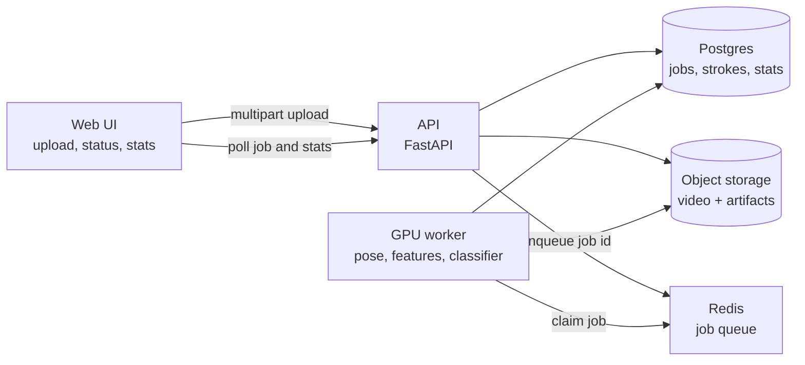
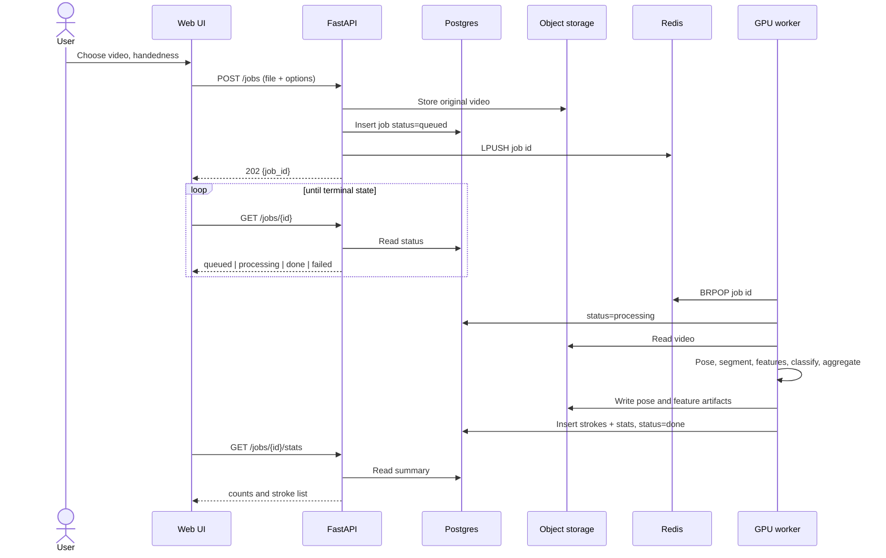
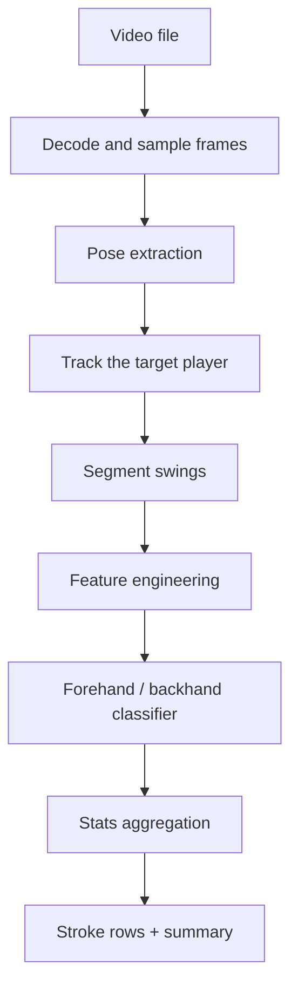

# Tennis stroke analyzer — architecture sketch

Web app that takes a tennis video filmed from **behind one player**, estimates body pose, derives swing features, classifies each swing as forehand or backhand, and shows counts. Later stats plug into the same stroke events.

## Assumptions

- One target player, camera behind them. Other people may appear; the pipeline keeps the largest, most central pose.
- Handedness is a job setting (default right). It flips the sign of “which side of the body” features. It does not hard-code the label.
- Pose models have no racket joint. v1 uses the forearm (elbow → wrist), extended past the wrist, as the racket axis. A small racket detector can replace that axis later without changing the classifier contract.
- Strokes are the unit of classification. A swing is a window around a wrist-speed peak, not a single frame.
- The browser never runs the production model. OpenCV.js is a slow demo path only.

## Components



| Piece | Role |
| --- | --- |
| Web UI | Upload a video, show job state, render stroke counts. |
| API | Accept the file, create the job, enqueue work, serve status and stats. Stays CPU-only and short-lived. |
| Redis | Hands job ids to the worker. The API returns immediately. |
| Object storage | Original video, sampled-frame index, pose JSON, feature rows. Local volume in dev; S3-compatible later. |
| Postgres | Job row, one row per detected stroke, one summary row per job. |
| GPU worker | Separate container. Decodes video, runs pose, builds features, classifies, writes results. |

The API and the worker share no Python process. They share the database, the object store, and the queue. The worker image carries CUDA, the pose runtime, and the classifier artifact. The API image does not.

## Data flow



Job states: `queued` → `processing` → `done` or `failed`. A failed job stores a short error string and keeps any partial artifacts for debugging. Re-queue is a new attempt on the same job id, not a second upload.

Suggested API:

| Method | Path | Purpose |
| --- | --- | --- |
| `POST` | `/jobs` | Multipart video, optional `handedness`. Returns `job_id`. |
| `GET` | `/jobs/{id}` | Status, progress fraction, error. |
| `GET` | `/jobs/{id}/stats` | Counts plus per-stroke list. |
| `GET` | `/jobs/{id}/overlay.mp4` | Optional later: skeleton and labels burned in. |

Progress is a single fraction the worker updates after pose, after segmentation, and after classification, so the UI can show a bar without streaming logs.

## ML pipeline



### 1. Pose extraction

Decode with OpenCV or PyAV. Sample at a fixed rate (start at 15 fps). Full source fps is wasted on pose and easy to turn back on.

Per sampled frame, run one of:

- **MediaPipe Pose (default).** 33 body landmarks, strong on a single nearby person, lighter than a detector-plus-pose stack. Fits a behind-the-player camera where the body is large in frame.
- **YOLO pose (fallback).** A pose head such as YOLOv8-pose when several people are visible and the tracker must start from person boxes. Heavier, better when MediaPipe locks onto the wrong body.

Landmarks kept: shoulders, hips, elbows, wrists. Drop the rest after smoothing.

Smoothing: 1-Euro or a short Savitzky–Golay on x/y before any angle is computed. Reject frames below a visibility threshold; interpolate gaps shorter than about 200 ms; end a swing window if the gap is longer.

**Racket axis, v1.** Direction elbow → wrist, extended by a fixed fraction of forearm length past the wrist. **v2.** A small detector (racket bounding box) replaces that ray. Downstream code reads `racket_axis` and does not care which produced it.

### 2. Feature engineering

Normalize positions by shoulder width so framing distance drops out. Image x increases to the player’s right when the camera is behind them; multiply x by −1 for a left-handed job before any side feature.

**Segmentation.** Wrist speed of the busier arm. A stroke is a peak above a threshold, with the window running from the preceding speed valley to the next. Merge peaks closer than ~0.3 s. Discard windows with too few valid frames.

**Per-window vector** (all scalars, fixed order, versioned with the model):

| Feature | Meaning |
| --- | --- |
| `contact_side` | Wrist x minus torso center x, at peak wrist speed, in shoulder-widths. Torso center is the midpoint of mid-shoulder and mid-hip. |
| `swing_dx`, `swing_dy` | Unit vector of wrist travel from window start to peak speed. This is arm swing direction. |
| `shoulder_dtheta` | Change in shoulder-line angle across the window. |
| `hip_dtheta` | Change in hip-line angle across the window. |
| `racket_body_angle` | Angle between racket axis and the torso axis (mid-shoulder → mid-hip) at peak speed. |
| `elbow_angle` | Interior elbow angle at peak speed. |
| `peak_wrist_speed` | Peak speed in shoulder-widths per second. |
| `cross_midline` | 1 if the wrist crosses the torso center during the window. |

The dominant arm is the wrist with the larger path length in the window. Serve and volley are not classes yet; very high contact (wrist above the shoulder line at the peak) can be labeled `other` by a pre-rule so the forest is not forced to call them groundstrokes.

Training rows are these vectors plus a label (`forehand`, `backhand`). Build the set offline from clips reviewed in the same UI. Store `feature_version` on every row.

### 3. Classification

**Random forest first** (scikit-learn, `joblib` artifact). It trains on a few hundred labeled swings, stays on CPU inside the GPU container, and exposes importances so a bad feature shows up early.

A **small MLP** (one hidden layer, same vector in) is the swap-in when labels grow or the forest plateaus. Same input contract, same three outputs: `forehand`, `backhand`, `other`. Confidence below a threshold (start at 0.55) is stored as `other` with the raw class kept in `raw_label`.

The classifier does not see pixels. Retraining ships a new artifact and a new `model_version`. Old jobs keep the version they were scored with.

### 4. Stats aggregation

Write one stroke row per window: `t_start`, `t_contact`, `t_end`, `label`, `confidence`, `model_version`, `feature_version`, and the feature JSON. Then a summary:

- `forehand_count`, `backhand_count`, `other_count`
- `duration_s`, `strokes_per_minute`
- mean `racket_body_angle` and mean `peak_wrist_speed` per label

Later stats (contact height, rotation speed, per-rally splits, an overlay video) are new queries or new columns on `strokes`. They must not require a second pose pass. Pose JSON stays in object storage so a new feature version can be recomputed by a batch job.

## Tech choices

| Choice | Why |
| --- | --- |
| **FastAPI** | Async upload, typed request bodies, OpenAPI for the UI. Flask is a fine smaller alternative if the team already uses it; the boundary stays the same. |
| **React (Vite)** | Upload progress, polling, and a stats view that will grow. A single `index.html` plus `fetch` is enough for the first demo and can live in `web/` until the view needs components. |
| **Postgres** | Jobs and stroke rows outlive the process and are easy to aggregate. SQLite is acceptable for a one-container prototype only. |
| **Redis list** | `LPUSH` / `BRPOP` is enough. Move to RQ or Celery only when retries, schedules, or multiple queues appear. |
| **GPU worker container** | Pose on a match-length video is the slow, heavy step. Isolating it keeps CUDA and model weights off the API image, and lets the API restart without killing inference. NVIDIA Container Toolkit in deploy; CPU image for laptops, with MediaPipe still correct and slower. |
| **MediaPipe Pose, YOLO pose as fallback** | MediaPipe matches the single-player framing. YOLO pose is the switch when detection must choose among people. Both emit the same landmark names into `pose.py`. |
| **Random forest** | Right size for a first labeled set. The MLP is a later artifact, not a second pipeline. |
| **OpenCV.js (slow alternative)** | A browser build can decode a short clip and run a JS pose model for a demo. The bundle is large, inference is much slower than the CUDA worker, and a long video blocks the tab. Keep it behind a “short clip, on device” flag. It should emit the same feature JSON the forest expects, so numbers stay comparable. Production traffic stays on the worker. |

## Folder layout

```text
tennis-stroke-analyzer/
  ARCHITECTURE.md
  docker-compose.yml          # api, worker, postgres, redis, minio
  api/
    Dockerfile
    pyproject.toml
    app/
      main.py                 # FastAPI app
      routes.py               # POST /jobs, GET status, GET stats
      db.py
      storage.py
      queue.py
  worker/
    Dockerfile                # CUDA base; CPU Dockerfile optional
    pyproject.toml
    worker.py                 # BRPOP loop, progress updates
    pipeline/
      decode.py
      pose.py                 # MediaPipe or YOLO, one landmark schema
      segment.py
      features.py
      classify.py             # loads models/stroke_rf.joblib
      stats.py
    models/
      stroke_rf.joblib
  web/
    index.html                # first upload page, or Vite src/ later
    package.json
  training/
    label_strokes.py          # offline: features + CSV labels -> joblib
    README.md
```

`docker-compose.yml` mounts one volume for objects, publishes the API and the web dev server, and sets `gpus: all` on the worker only. The API service has no GPU reservation.

## What is deliberately out of scope

Ball tracking, court homography, bounce detection, opponent strokes, and user accounts. The stroke table is the extension point: new stats read it, and a richer model only replaces `classify.py` plus the artifact.
